前提都是https://www.figma.com/design/UX8tP4LjOjAkBx1Ji3wY8O/Data-Assistant?node-id=22-372&t=56HI838sf85ScjgK-0这个地址的所有UI设计图根据这个按照下面的flow开发对应的模块以及生成代码
1. 首页就是figma里面的Sidebar Expand 对应的模块.按照这个样式生成首页.
2. 当左侧菜单收起来时是Collapse sidebar模块, 左侧slider收起来展示对应的icon.
3. Example, 点击输入框里面左边的"/"icon展示下面的Example或者是在Input输入/来展示都可以.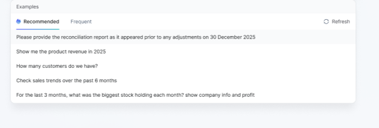, Frequent 是展示最近使用比较频繁的例句，他和Example是Tab页可以切换. Example 类似于下拉框那种弹出,点击空白处就又会收起来,输入框发送按钮默认是disabled状态.
4. No template, no example, 当template和example都为空时,展示这个模块 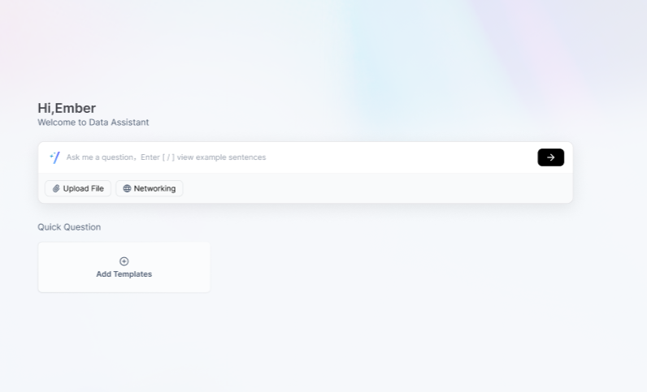, 如果用户再没有权限也没有template和example时展示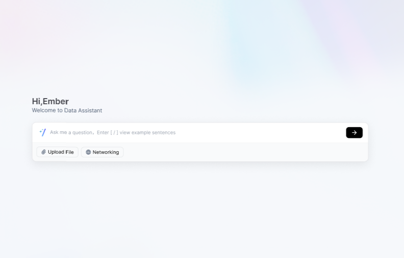.
5. Templates are available, 如果template和example的list都不为空时展示此模块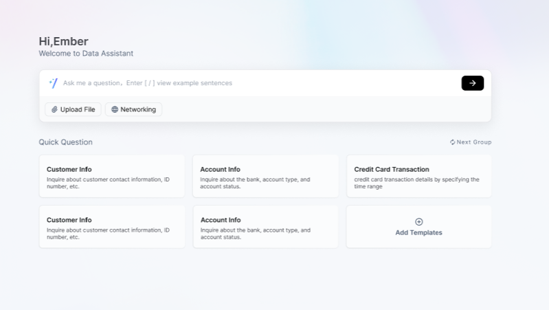.
6. No template, example available模块, 如果template为空而example不为空时展示此模块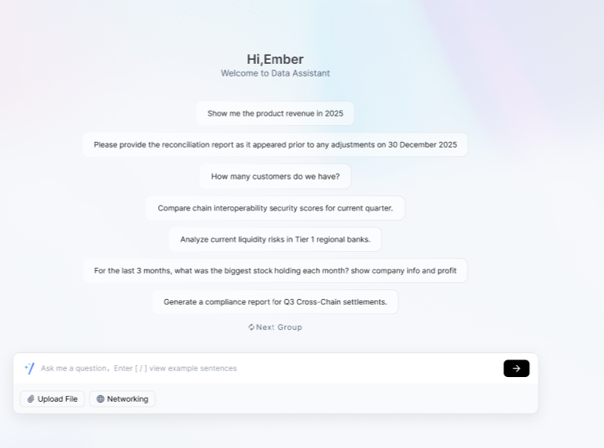, example list像这样展示，templete则不展示.
7. 点击不同的templete card时按照配置可以弹出Modal, Modal Content为可配置的Form表单, Before input 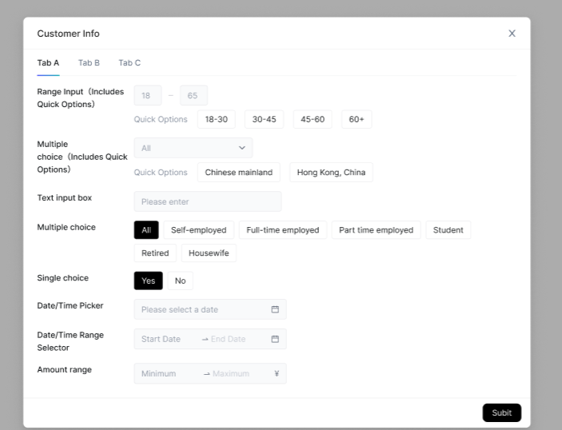, 按照次模块进行这些组件的封装，组件类型大约有Slider, Select, Input, Radio, 时间选择器, 最小最大值的输入等图中所示组件.点击不同类型的templete，根据不同配置的表单json格式来渲染不同的组件来展示对应的Form表单.
8. 当选择完templete里面的表单之后点击Modal 的submit按钮就相当于点击了input的发送按钮, 直接触发流式接口答案堆叠模块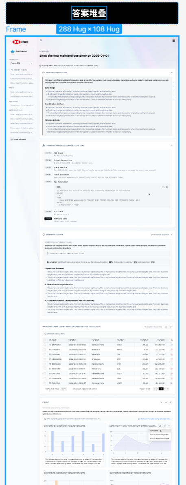.
9. 点击slider最底下的show metadata按钮展示Show metadata模块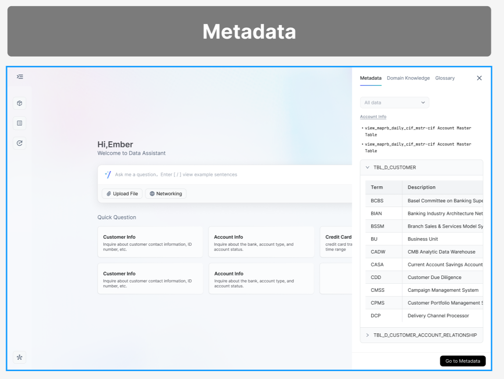.
10. 当流式接口返回完成时底部会出来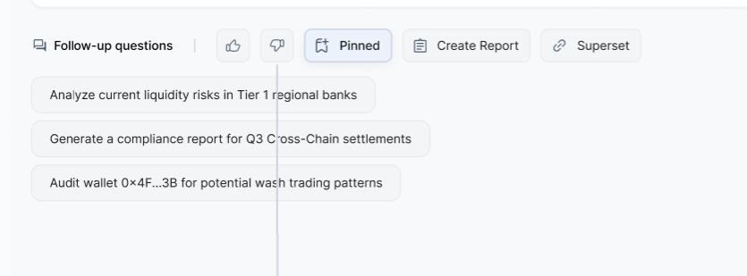类似于图中的这些操作.参考ALL这个模块.
11. 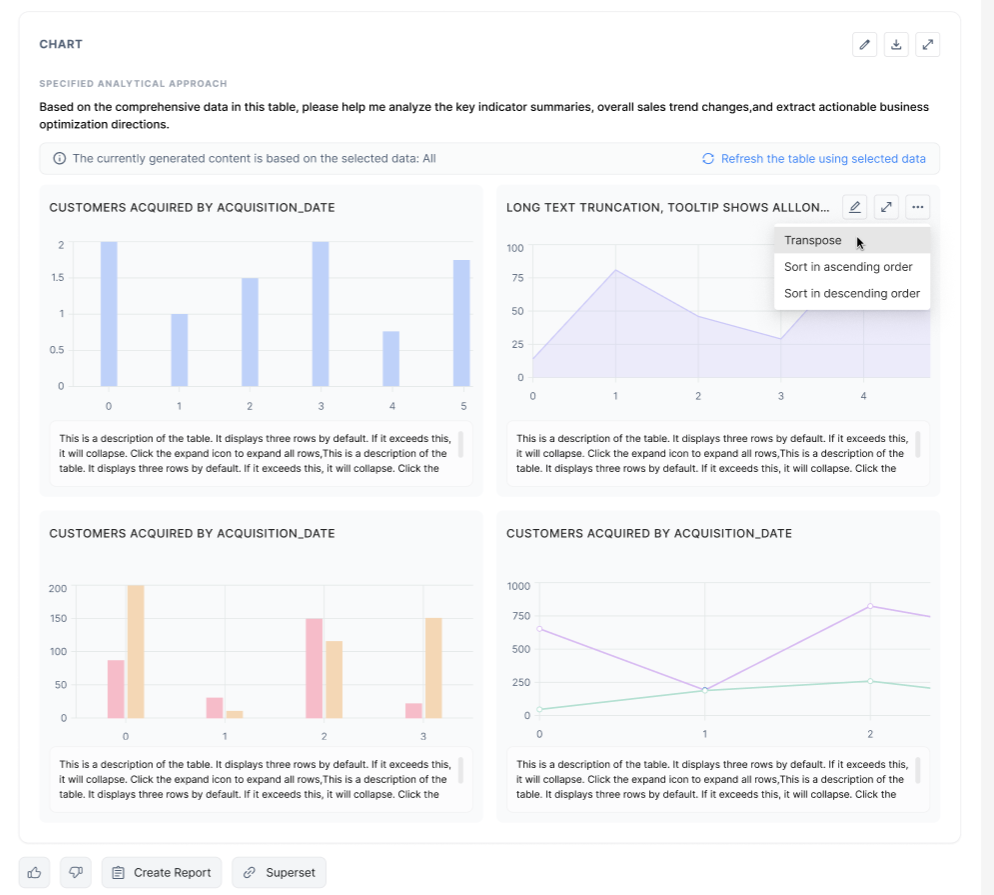 渲染Chart时使用vega-lite插件如图所示一行排2个图, 图表标题右侧支持全屏和下载以及编辑功能.
12. 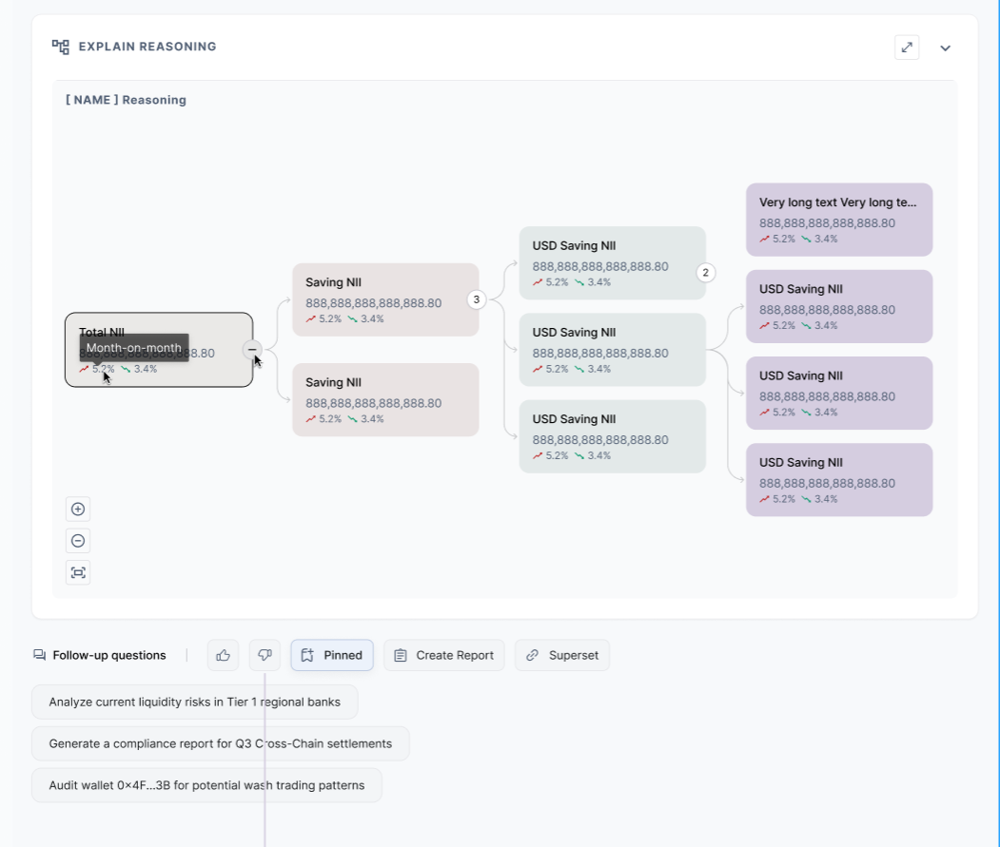 React 使用@xyflow/react插件去渲染.
13. 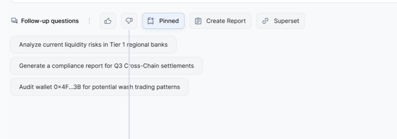 点击FeedBack按钮时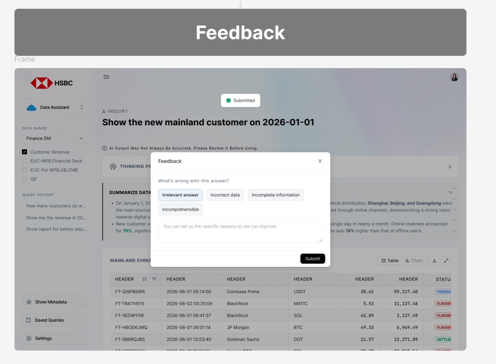弹出这个Modal。